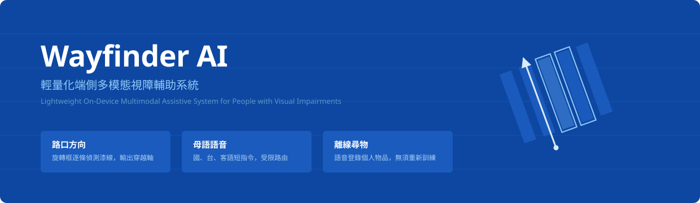
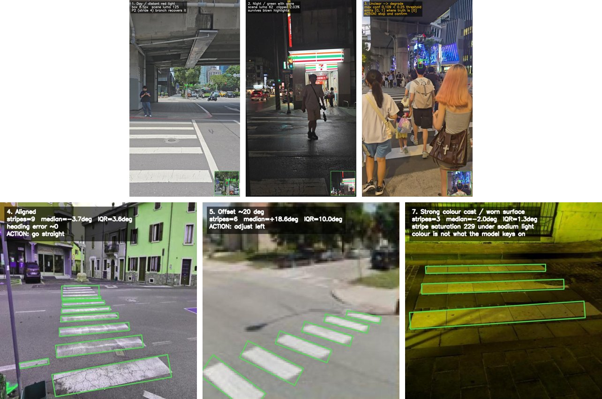
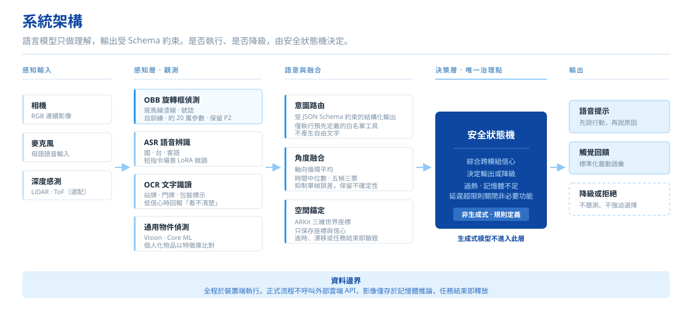
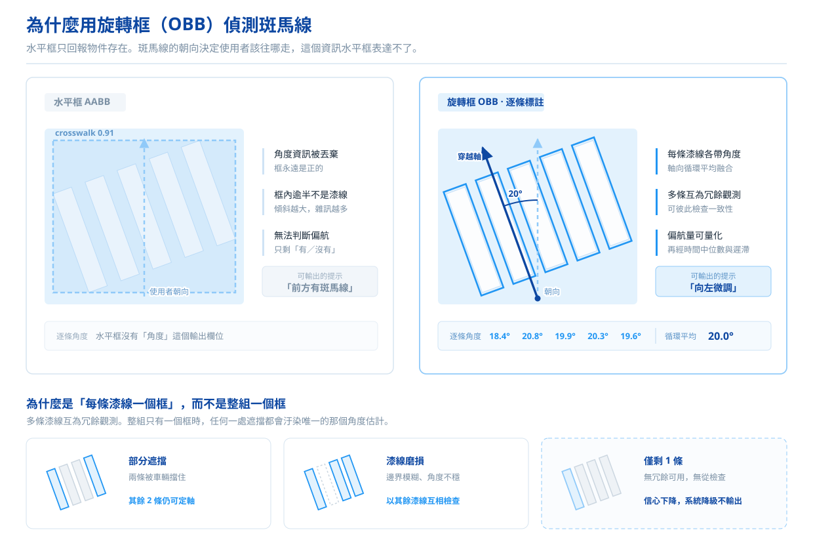
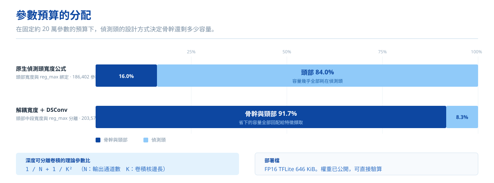
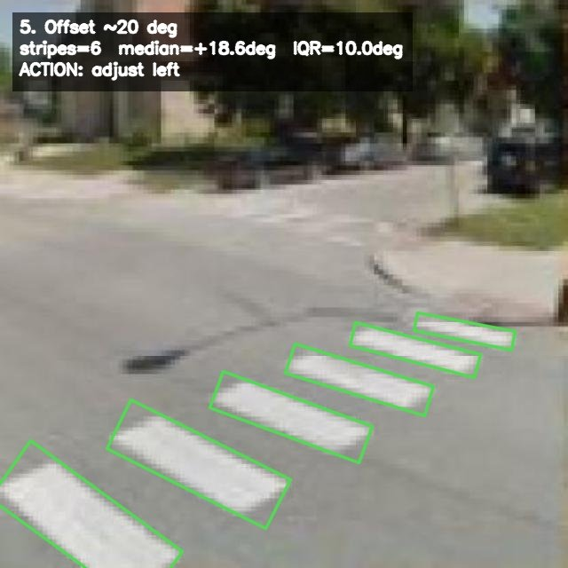
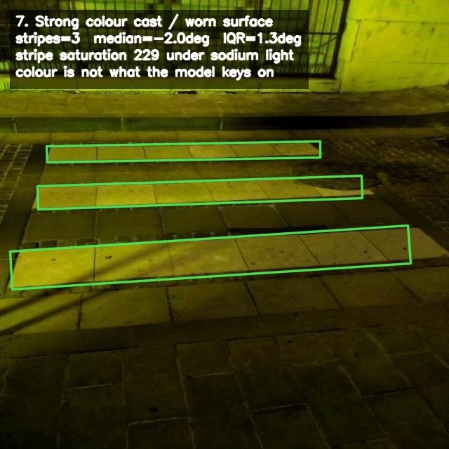
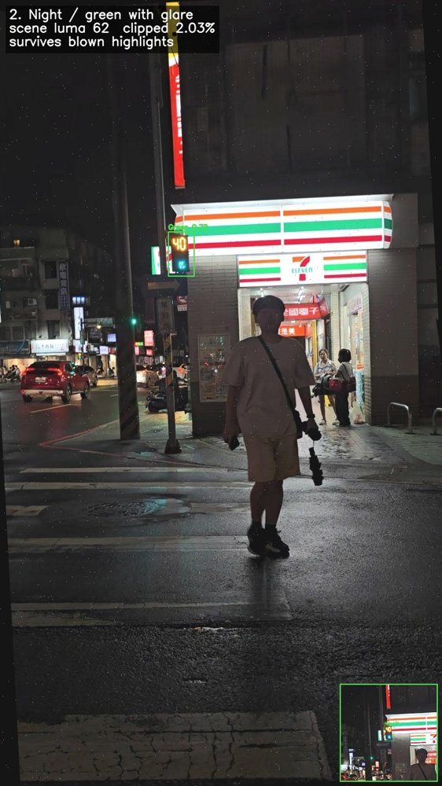
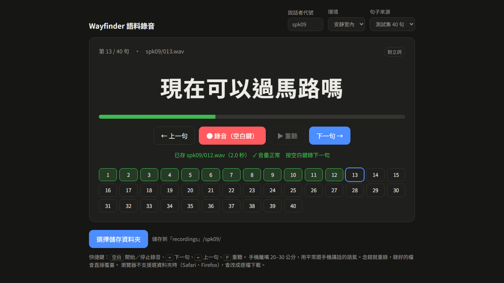

<div align="center">



<br><br>

[](wayfinder-obb/LICENSE)
[](#1-obb-模型)
[](#1-obb-模型)
[](#系統架構)
[](#快速開始)

**[模型](#開源內容)**　|　**[架構](#系統架構)**　|　**[快速開始](#快速開始)**　|　**[授權](#授權)**

</div>

<br>

---

## 簡介

Wayfinder AI 是在行動裝置上離線執行的視障輔助系統，處理三件事：判斷是否對準斑馬線、讀取號誌狀態、找回使用者事先登錄過的個人物品。推論全部在裝置端完成，影像不離開手機。

語音入口以 Taiwan Tongues ASR CE 為基底，原生支援國語、台語與客語。依衛生福利部統計處資料，2024 年第 3 季全國視障者 54,001 人，65 歲以上 31,223 人，佔 57.8%，其中不少人不慣用華語介面。



<sub>上排：行人號誌（白天遠距紅燈、夜間眩光、看不清時停下確認）。下排：斑馬線漆線旋轉框（對準時直走、偏 20 度時提示向左、鈉燈色偏下仍依形狀辨識）。全部為本倉庫釋出權重的實際輸出。</sub>

### 設計取捨

- **安全輸出由規則決定，不由模型決定。** 語言模型只把語音轉成受 JSON Schema 約束的結構化指令，App 僅執行白名單內的工具。格式錯誤、缺參數或語意矛盾時拒絕執行，退回規則分類器或追問一個必要欄位。
- **用旋轉框偵測斑馬線。** 水平框無法表達漆線朝向，因此也無法判斷使用者有沒有走歪。
- **偵測頭中段寬度與 `reg_max` 解耦，並改用深度可分離卷積。** 在約 20 萬參數的預算下，頭部佔總參數的比例從 84.0% 降到 8.3%，省下的容量回配給骨幹。
- **保留步幅 4 的 P2 層。** 遠距號誌在畫面中常只有 8–21 像素，從 P3 起始的偵測尺度容易漏檢。號誌模型對小於 24 像素的燈號召回率為 0.955。
- **低於信心門檻時繼續掃描，不輸出最相似的候選。** 尋物給錯方向，比暫時找不到更危險。

> 號誌辨識結果只作為環境資訊。系統不會單獨輸出「可以通行」。

<br>

## 系統架構



<br>

## 開源內容

| | 內容 | 授權 |
|:--|:--|:--|
| **1. OBB 模型** | 斑馬線 OBB（640／320）與號誌偵測：`.pt` · ONNX · FP16 TFLite · `model.yaml` · 模型卡 | AGPL-3.0 |
| **2. 訓練與評估** | `train.py` · `export.py` · `eval.py` · 評估結果 · 標註規範 | AGPL-3.0 |
| **3. ASR 微調** | LoRA adapter · `train_lora.py` · `eval_baseline.py` · 微調前後 CER · 測試集錄製網站 | TRAIL v0.1 |

<br>

### 1. OBB 模型



<br>


<br>



<br>

| 模型 | 任務 | 輸入 | 參數 | mAP50（FP16） | FP16 部署檔 | CPU 延遲 |
|:--|:--|--:|--:|--:|--:|--:|
| `crosswalk_obb_640` | 斑馬線漆線旋轉框 | 640 | 203,570 | 0.862 | 646 KiB | 17.4 ms |
| `crosswalk_obb_320` | 斑馬線漆線旋轉框 | 320 | 195,016 | 0.848 | 649 KiB | 11.7 ms |
| `traffic_light_640` | 行人號誌（綠／紅） | 640 | 198,840 | 0.990 | 950 KiB | 23.3 ms |

<sub>斑馬線以 362 張來源影像不與訓練重疊的 clean_test 評估；號誌以 3,384 張驗證集評估。延遲為 Intel i7-13700K CPU、4 執行緒、只計網路前向。</sub>

<table>
<tr>
<td width="33%"><br><sub>9 條漆線，中位角 −3.7°，判斷直走</sub></td>
<td width="33%"><br><sub>6 條漆線，中位角 +18.6°，提示向左修正</sub></td>
<td width="33%"><br><sub>鈉燈下的黃色路面，依形狀而非顏色辨識</sub></td>
</tr>
<tr>
<td width="33%"><br><sub>白天遠距紅燈，燈號約 8.5 px，由 P2 分支偵測到</sub></td>
<td width="33%"><br><sub>夜間綠燈，畫面有高光溢出仍可辨識</sub></td>
<td width="33%"><br><sub>最高信心 0.109 低於門檻 0.25，停下並請使用者確認</sub></td>
</tr>
</table>

| 檔案 | 說明 |
|:--|:--|
| `models/crosswalk_obb_640.pt`、`crosswalk_obb_320.pt`、`traffic_light_640.pt` | 訓練輸出 |
| `models/*.onnx` | ONNX 匯出 |
| `models/*_fp16.tflite` | FP16 TFLite 部署檔，646–950 KiB |
| `configs/*.yaml` | 架構定義：解耦頭部寬度、`reg_max`、P2 層 |
| `MODEL_CARD.md` | 架構、參數量、資料來源、評估數字、已知限制 |

目錄：[`wayfinder-obb/`](wayfinder-obb/)　·　模型卡：[`MODEL_CARD.md`](wayfinder-obb/MODEL_CARD.md)　·　評估：[`results.md`](wayfinder-obb/eval/results.md)

<br>

### 2. 訓練與評估程式碼

資料集本身不隨倉庫釋出。標註規範與評估腳本完整公開，其他團隊可自行標註後重訓同一架構，或替換為其他場域的號誌樣式。

| 檔案 | 說明 |
|:--|:--|
| `training/train.py` | 訓練（三個模型共用，設定在 `configs/train.yaml`） |
| `training/export.py` | pt → ONNX → FP16 TFLite |
| `eval/eval.py` | 評估，號誌另可依燈號大小分段計算召回率 |
| `eval/results.md` | mAP、召回率、各尺度分解、量化與解析度的影響 |
| `docs/annotation_spec.md` | 標註規範 |

> 切分以來源照片為單位，不隨機切。同一張照片的增強副本、同一路口的連續影格高度相似，隨機切會讓訓練與測試出現幾乎相同的畫面。

<br>

### 3. ASR 微調成果

基底為數位產業署開源的 **Taiwan Tongues ASR CE**，whisper-large-v2 架構，15.5 億參數，支援國台客英。

微調目標是降低路口噪音下短指令的字元錯誤率，同時保留原模型的一般辨識能力。

| 測試集 | 說明 | 微調前 | 微調後 |
|:--|:--|--:|--:|
| **真人 40 句** | 錄音者未參與訓練；40 句中有 38 句的文字出現在訓練語料 | 4.51% | **0.00%** |
| 代理測試・乾淨 | 4 個訓練從沒出現過的合成聲音 | 3.07% | **0.31%** |
| 代理測試・加噪音 | 同上，再加訓練沒用過的 8 類環境噪音 | 4.71% | **0.31%** |
| 官方真人 200 句 | Taiwan Tongues 國語測試集，檢查一般國語能力有沒有退化 | 18.99% | **11.62%** |
| 官方・排除英文幻覺 | 扣掉原模型輸出整句英文的 4 句 | 12.97% | **11.08%** |

> 總體 CER 會掩蓋少數高風險錯誤。真人測試中，原模型把「現在是**紅**燈嗎」聽成「現在是**弘**燈嗎」，微調後修正；紅燈／綠燈、左／右、可以／不可以等六組最小對立組全部 0 錯。



<sub>測試集錄製網站（`wayfinder-asr-finetune/tools/recorder/`）。一次顯示一句，空白鍵開始／停止，錄完自動檢查音量與長度，直接存成 16 kHz 單聲道 WAV 與對應的 TSV。</sub>

語料本身不公開，受試者同意範圍不涵蓋釋出。語料需求與切分方式完整公開，以利檢驗上表數字。

目錄：[`wayfinder-asr-finetune/`](wayfinder-asr-finetune/)　·　模型卡：[`MODEL_CARD.md`](wayfinder-asr-finetune/MODEL_CARD.md)　·　結果：[`results.md`](wayfinder-asr-finetune/results/results.md)

<br>

## 快速開始

<details>
<summary><b>OBB 模型：推論、訓練與評估</b></summary>

<br>

```bash
git clone https://github.com/yu9bryan/wayfinder-ai.git && cd wayfinder-ai/wayfinder-obb
pip install -r requirements.txt
```

```bash
python predict.py --model crosswalk_obb_640 street.jpg
```

```bash
python training/train.py --model crosswalk_obb_640
```

```bash
python eval/eval.py --model crosswalk_obb_640 --data configs/data_crosswalk.yaml --fmt tflite
```

</details>

<details>
<summary><b>ASR 微調：單張 16 GB 顯卡可跑</b></summary>

<br>

官方全參數微調需求為 VRAM 40 GB 以上。本專案以 LoRA 將可訓練參數壓到 786 萬（0.51%），訓練時 VRAM 峰值約 5 GB。

```bash
conda create -n ttasr python=3.11 -y && conda activate ttasr
pip install -r requirements.txt
```

要下載可微調的 HuggingFace 格式。推論用的 CTranslate2 格式不能微調。

```bash
hf download adi-gov-tw/Taiwan-Tongues-ASR-CE-pretrained-v1.0 --local-dir model_for_finetune
```

```bash
python eval_baseline.py --corpus sample_corpus/wayfinder_cmd --tag baseline                            # 先跑基準
python train_lora.py    --datasets wayfinder_cmd --out out/lora-wayfinder
python eval_baseline.py --corpus sample_corpus/wayfinder_cmd --adapter out/lora-wayfinder --tag v1     # 再比對
```

</details>

<br>

## 授權

| 元件 | 授權 | 備註 |
|:--|:--|:--|
| 自訓練 OBB 與號誌權重 | `AGPL-3.0` | 訓練管線採 Ultralytics，依其 copyleft 要求 |
| 訓練與評估程式碼 | `AGPL-3.0` | 與權重一致 |
| ASR LoRA adapter 與程式碼 | `TRAIL v0.1` | 衍生自 Taiwan Tongues ASR CE，見 [`LICENSE`](wayfinder-asr-finetune/LICENSE)、[`NOTICE.md`](wayfinder-asr-finetune/NOTICE.md) |
| Taiwan Tongues ASR CE | `TRAIL v0.1` | 第三方，數位產業署 |
| Gemma 4 E2B IT | `Apache-2.0` | 第三方 |

<details>
<summary><b>關於 AGPL-3.0 的適用範圍</b></summary>

<br>

訓練管線採用 Ultralytics YOLO（AGPL-3.0）。依其 copyleft 要求，訓練程式碼與訓練所得權重一併以 AGPL-3.0 釋出。

行動應用端以 Core ML、ONNX Runtime 等推論引擎執行，不連結任何 Ultralytics 程式碼，且為裝置端離線推論，不構成 AGPL-3.0 第 13 條所指之網路服務。

使用本權重建置對外網路服務者，須自行確認第 13 條之義務。

</details>

<details>
<summary><b>關於 TRAIL v0.1</b></summary>

<br>

Taiwan Tongues ASR CE 的模型授權為 TRAIL（TWM Responsible AI License）v0.1，結合 LGPL 式的共享要求與 RAIL 式的使用限制。
LoRA adapter 屬於衍生作品，依 TRAIL-M 公開權重；再散布時須附上授權全文、修改說明與使用限制。
只呼叫、不修改模型的應用程式可自行選擇授權。

</details>

<br>

## 安全聲明

本專案為研究與競賽用途的原型，不是醫療器材，也不是通過認證的輔具。

系統輸出不得單獨作為通行決策依據。實際使用時務必併用白手杖、導盲犬或其他既有輔具。
