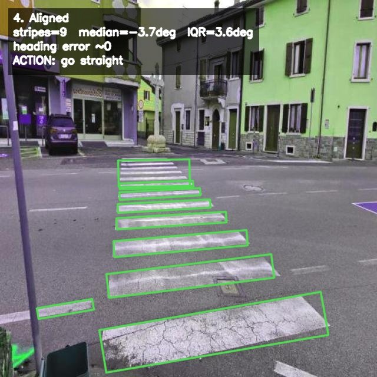
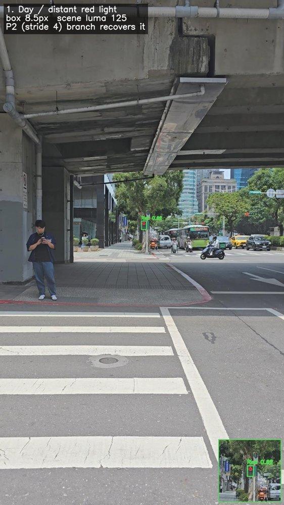
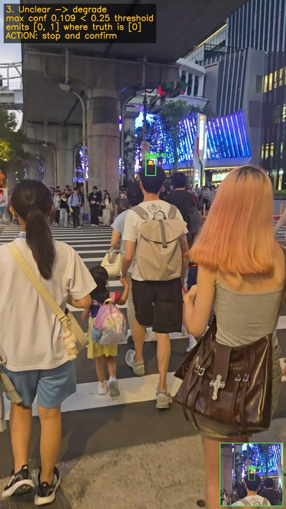

# wayfinder-obb

斑馬線漆線旋轉框（OBB）與行人號誌偵測模型。每個模型約 20 萬參數，FP16 部署檔 646–950 KiB，可在行動裝置端離線執行。


<sub>上排：紅綠燈（白天遠距紅燈、夜間眩光、看不清時降級）。下排：斑馬線（對準、偏 20 度、強烈色偏）。全部為本倉庫 `models/` 內權重的實際輸出。</sub>

---

## 模型

| 模型 | 任務 | 輸入 | 參數 | mAP50（fp16） | FP16 檔案 | CPU 延遲 |
|:--|:--|--:|--:|--:|--:|--:|
| `crosswalk_obb_640` | 斑馬線漆線旋轉框 | 640 | 203,570 | 0.862 | 646 KiB | 17.4 ms |
| `crosswalk_obb_320` | 斑馬線漆線旋轉框 | 320 | 195,016 | 0.848 | 649 KiB | 11.7 ms |
| `traffic_light_640` | 行人號誌（綠／紅） | 640 | 198,840 | 0.990 | 950 KiB | 23.3 ms |

斑馬線以 362 張來源不與訓練重疊的 `clean_test` 評估；紅綠燈以 3,384 張驗證集評估。延遲為 Intel i7-13700K CPU、4 執行緒、只計網路前向。
完整數字見 [`eval/results.md`](eval/results.md)，架構、資料與限制見 [`MODEL_CARD.md`](MODEL_CARD.md)。

---

## 用途

水平框只回報物件存在，無法描述漆線朝向，也就無法判斷使用者是否偏航。
本模型逐條偵測漆線，各條漆線的角度經軸向循環平均融合為穿越軸，再輸出「向左微調」「向右微調」或「方向已對準」。

<table>
<tr>
<td width="33%"><br><sub>9 條漆線，中位角 −3.7°，判斷直走</sub></td>
<td width="33%"><br><sub>6 條漆線，中位角 +18.6°，提示向左修正</sub></td>
<td width="33%"><br><sub>鈉燈下的黃色路面，模型依形狀而非顏色辨識</sub></td>
</tr>
</table>

遠距號誌在畫面中常只有 8–21 像素。從 P3 起始的偵測尺度下，16 像素目標在步幅 8 的特徵圖上只橫跨約 2 個格點；
紅綠燈模型保留步幅 4 的 P2 層（約 4 個格點），並同步壓縮通道數與偵測頭，守住參數預算。

<table>
<tr>
<td width="33%"><br><sub>白天遠距紅燈，燈號約 8.5 px，由 P2 分支偵測到</sub></td>
<td width="33%"><br><sub>夜間綠燈，畫面有高光溢出仍可辨識</sub></td>
<td width="33%"><br><sub>最高信心 0.109 低於門檻 0.25，應用端停下並請使用者確認</sub></td>
</tr>
</table>

---

## 參數預算分配

同樣約 20 萬參數：

| 設定 | 偵測頭佔比 |
|:--|--:|
| 原生偵測頭，骨幹等比例縮小（186,402 參數） | 84.0% |
| 偵測頭寬度與 `reg_max` 解耦＋深度可分離卷積（`crosswalk_obb_640`，203,570 參數） | **8.3%** |

省下的容量回配給骨幹。深度可分離卷積相對一般卷積的理論參數比為 `1/N + 1/K²`（N：輸出通道數，K：卷積核邊長）。

---

## 檔案

| 路徑 | 說明 |
|:--|:--|
| `models/<模型>.pt` | PyTorch 權重（需先套用 head patch，`wayfinder_obb.load()` 會自動處理） |
| `models/<模型>.onnx` | ONNX 匯出，已 simplify |
| `models/<模型>_fp16.tflite` | TFLite fp16 部署檔，輸入尺寸固定 |
| `configs/<模型>.yaml` | 架構定義 |
| `configs/train.yaml` | 三個模型的訓練超參數 |
| `configs/data_*.yaml` | 資料集格式範例 |
| `wayfinder_obb/` | 載入器與 head patch |
| `predict.py` | 推論示範 |
| `training/train.py` | 訓練 |
| `training/export.py` | pt → ONNX → TFLite fp16 |
| `eval/eval.py` | 評估 |
| `eval/results.md` | 評估結果 |
| `docs/annotation_spec.md` | 標註規範 |
| `MANIFEST.csv` | 每個模型檔的大小與 SHA-256 |

---

## 使用

```bash
pip install -r requirements.txt
python predict.py --model crosswalk_obb_640 street.jpg
python predict.py --model traffic_light_640 --fmt tflite crossing.jpg
```

在自己的程式裡：

```python
from wayfinder_obb import load

zebra = load("crosswalk_obb_640")              # .pt，自動套用 head patch
for r in zebra("street.jpg", imgsz=640):
    print(r.obb.xywhr, r.obb.conf)             # 中心、寬高、旋轉角（弧度）、信心

light = load("traffic_light_640", "onnx")      # ONNX／TFLite 不需要 patch
```

`.pt` 只存權重，載入前要先重建相同的窄偵測頭；head patch 會改 Ultralytics 類別本身，
**同一個 process 只能載入同一種 patch 的 `.pt`**。要同時跑斑馬線和紅綠燈，請用 ONNX 或 TFLite。

### 部署注意

- 用 fp16 或 fp32。偵測頭含 DFL 分佈回歸，全整數量化（int8）會大幅掉精度。
- 用訓練時的解析度推論：`crosswalk_obb_640` 用 640、`crosswalk_obb_320` 用 320。
- TFLite 輸入為 NHWC、RGB、0–1 正規化，尺寸固定。
- ONNX 與 TFLite 輸出未做 NMS，請在部署端處理。

---

## 重現

```bash
git clone https://github.com/yu9bryan/wayfinder-ai.git
cd wayfinder-ai/wayfinder-obb
pip install -r requirements.txt
```

訓練（資料集依 [`docs/annotation_spec.md`](docs/annotation_spec.md) 準備，路徑填進 `configs/data_*.yaml`）：

```bash
python training/train.py --model crosswalk_obb_640
python training/train.py --model traffic_light_640
```

匯出：

```bash
python training/export.py --model crosswalk_obb_640 --weights runs/train/crosswalk_obb_640/weights/best.pt
```

評估：

```bash
python eval/eval.py --model crosswalk_obb_640 --data configs/data_crosswalk.yaml --fmt tflite
python eval/eval.py --model traffic_light_640 --data configs/data_traffic_light.yaml --split val --by-size
```

資料集未隨倉庫釋出。

---

## 授權

本倉庫以 **AGPL-3.0** 釋出，包含模型權重，全文見 [`LICENSE`](LICENSE)。

訓練管線採用 Ultralytics YOLO（AGPL-3.0）。依其 copyleft 要求，訓練程式碼與訓練所得權重一併以 AGPL-3.0 釋出。

使用本權重的應用若透過網路對外提供服務，須注意 AGPL-3.0 第 13 條的義務。

---

## 貢獻者設定

本倉庫 commit 不使用真實姓名。clone 後請先設定倉庫層級身分：

```bash
git config user.name "wayfinder-ai"
```

```bash
git config user.email "<你的ID>+<你的帳號>@users.noreply.github.com"
```

**不要用 `--global`**，以免影響其他專案。
